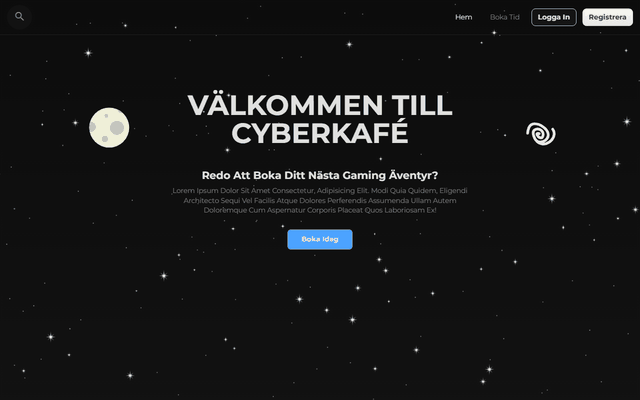

# Cyberkafé booking system

A booking site for a cybercafé, built for a university web programming course. Visitors register, log in, search for something to book, book a time and see their own bookings. Behind it all runs an animated starfield drawn on an HTML5 canvas: click a star and it grows, click it again and it explodes.

The interface is in Swedish.

## What it does

- **Booking flow**: registration, login, resource search, booking and a list of the customer's bookings, all against a PHP backend that answers in XML.
- **Single-page navigation**: pages and modals switch without reloads, and the browser's back and forward buttons work through the History API.
- **Form handling**: fields are validated as you type, each with its own regular expression and error message, and inputs are kept in `localStorage` so a reload doesn't lose them.
- **Canvas engine**: a small node and sprite system, loosely modelled on Godot, with frame animation, movement, screen wrapping and click detection. About 200 stars, a moon and a galaxy run in one `requestAnimationFrame` loop.
- **React for one view**: the customer's bookings table is a React component, loaded from a CDN with in-browser Babel.

## Built with

Plain JavaScript, HTML and CSS, the Canvas 2D API, the Fetch and History APIs, and React 16.

## Running it

Opening `index.html` in a browser shows the site and the canvas. The booking features need the course's PHP backend, which is not part of this repo: the frontend expects it at `../API/booking/` on the same server.
